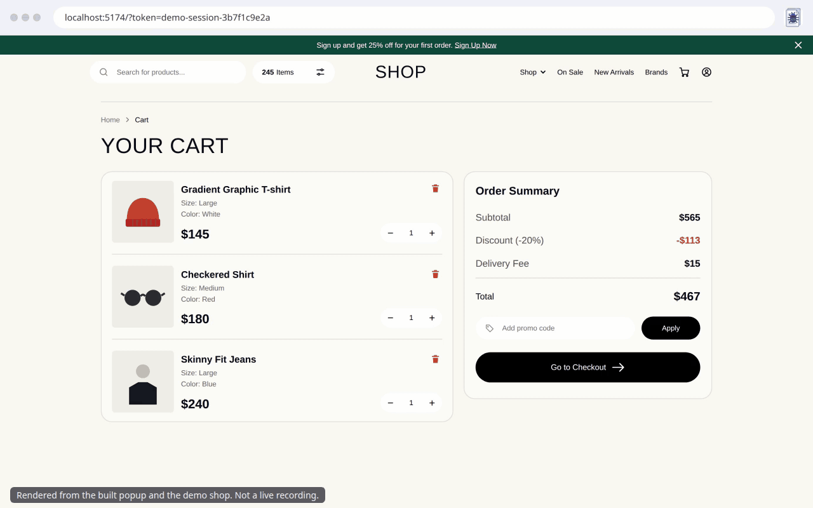

# BugBrief

Hand a broken page to an AI coding agent in one click.

BugBrief is a Chrome extension. You record the broken tab, point at the broken element, and it produces one Markdown report with the console errors, the failed requests and their responses, the element's HTML and styles, and a screenshot. Secrets in the report text are removed before anything is shown, so you can paste it into Claude Code or Cursor with far less worry. The screenshot is not redacted, and redaction is pattern based, so check the image and give the report a quick read before you share it.



*The animation is rendered from the built popup and the demo shop with scripted extension state, not a live screen recording.*

## What the report contains

- Uncaught exceptions with stacks, and console errors and warnings.
- Failed requests (network errors and responses with status 400 or above), with request and response bodies.
- Each distinct problem once, with an occurrence count, a summary table, and a hint when an error was likely caused by a failed request.
- The element you picked: a unique selector, its `outerHTML`, key computed styles and its position.
- A screenshot of that element, saved as a separate `.png` that you attach to your agent.
- Your own note: what you expected and what happened.

## Requirements

- Chrome 118 or newer.
- Node.js 22 or newer, to build it.

## Install

BugBrief is not on the Chrome Web Store yet. Build it and load it unpacked:

```bash
git clone https://github.com/Junaid-Salman/bugbrief.git
cd bugbrief
npm ci
npm run build
```

Then open `chrome://extensions`, turn on **Developer mode**, choose **Load unpacked** and select the `dist/` folder. Pin the BugBrief icon.

## Try it on the demo shop

The repo ships a cart page (a copy of a shop design) with two planted bugs: an error thrown while the cart summary renders, and a checkout request that fails with a 500 and tells the user nothing.

```bash
npm run demo
```

1. Open <http://localhost:5174/?token=demo-session-3b7f1c9e2a>. The page looks fine: that is the point, nothing on screen says that checkout fails.
2. Click the BugBrief icon, then **Start recording**. Chrome shows a banner, "BugBrief started debugging this browser". That is expected: it is how BugBrief reads errors from the tab.
3. Reload the page. The error and the failed request happen on load, so they are captured. Errors that happened before you clicked Start are not.
4. Click the BugBrief icon again. Click **Stop recording**.
5. Click **Pick element**. The popup closes. Move over the Order Summary card and click it. (Press `Esc` to cancel.)
6. Click the BugBrief icon again. The popup says the screenshot was captured. Type what you expected, then click **Preview**.
7. The preview shows how many values were redacted, for example "7 values redacted", and a warning that the screenshot is not redacted. Click **Copy**, or **Download** to save the `.md` and `.png`.

Open the report and check it: the `token` in the page address, the `Authorization` header and the customer's email must not appear. If one does, that is a bug: see [Reporting a leak](#reporting-a-redaction-leak).

### Let an agent fix it

```bash
npm run demo:reset
```

Open your agent in this repo, paste the report, and ask it to fix the problems it describes in `demo/shop/`. Run `npm run demo:reset` afterwards to restore the broken files. The reset only touches `demo/shop/`.

`http://localhost:5174/lab` is a bench with buttons for edge cases: many distinct errors, large and binary response bodies, a frozen page and more. It is what the manual checks use.

## Use it on your own page

Same steps as the demo: open your page, **Start recording**, reproduce the bug (reload first if the error happens on load), **Stop recording**, optionally **Pick element**, then **Preview** and **Copy**.

- Pick from a freshly opened popup. A page reload ends the permission the popup was given.
- Use `http://localhost` or a normal website. `file://` pages need "Allow access to file URLs" for BugBrief in `chrome://extensions`.
- **Clear** removes the recording, the picked element and your note.

## Permissions

| Permission | Why BugBrief needs it |
|---|---|
| `debugger` | Reads console errors, exceptions and failed requests (and their response bodies) from the tab you start recording. It attaches only after you click **Start recording**, only to that tab, and detaches when you stop. |
| `activeTab` | Gives BugBrief access to the tab you opened the popup on, without asking for access to every site. |
| `scripting` | Injects the element picker into that tab when you click **Pick element**. |
| `storage` | Keeps the recording in memory (`chrome.storage.session`) so it survives the extension's background worker restarting, and remembers that you have read the first-run notice. |
| `downloads` | Saves the report and the screenshot when you click **Download**. |

BugBrief asks for no host permissions and loads no remote code.

## Privacy

No data leaves your machine. BugBrief has no server, no account, no analytics and no network requests of its own. The recording lives in `chrome.storage.session`, which Chrome clears when the browser closes. The report goes only to your clipboard or to files you download.

Redaction runs before anything reaches the popup, your clipboard or a file. It covers query parameters in page and request URLs, JSON bodies, console text, element HTML (including password and hidden input values) and email addresses. Request headers are not put in the report at all. **The screenshot is not redacted.** The preview warns you, and you should look at it before you share it. Redaction is on by default and cannot be turned off. Always read the report before you share it.

## Known limitations

- Errors that happen before you click **Start recording** are not captured. Start, then reload.
- Console output and requests from iframes, Web Workers and page service workers are not captured.
- Only one tab is recorded at a time.
- The screenshot is the visible part of the page and one element. An element taller than the window is cropped to the window, and the report says so. A pinch-zoomed page crops wrongly.
- BugBrief cannot run on `chrome://` pages, other extensions' pages, `view-source:` pages or the Chrome Web Store.
- Chrome shows "BugBrief started debugging this browser" while recording. Clicking **Cancel** on it ends the recording and keeps what was captured.
- If another extension or a stale session already holds the tab, Chrome refuses to attach. Disable other debugging extensions and try again.
- Redaction is pattern based. It can miss a secret it does not recognize.

## Reporting a redaction leak

If a secret reaches a report, please [open an issue](https://github.com/Junaid-Salman/bugbrief/issues) and describe the field it was in, but not the secret itself. Every confirmed leak becomes a regression test.

## Development

```bash
npm run dev       # build with watch, load dist/ unpacked
npm run build     # type check, then build into dist/
npm test          # unit tests
npm run demo      # demo shop and test bench on http://localhost:5174
npm run demo:reset
```

## License

[MIT](LICENSE). Copyright (c) 2026 Junaid Salman.
